  <picture>
    <source media="(prefers-color-scheme: dark)" srcset="assets/logo-dark.png">
    <source media="(prefers-color-scheme: light)" srcset="assets/logo-light.png">
    
  </picture>

### Aditya Gaurav · AI Systems Architect

**Building the layer between research and production.**

I build AI systems (agents, evaluation, sandboxes) and fix the infrastructure they run on: TensorFlow kernels and XLA, gVisor's sandboxed kernel, Grafana, and oh-my-pi. I write about it at [adityaai.dev](https://www.adityaai.dev).

> The model proposes. Deterministic arbiters dispose.

### Lab

**[MidSphere](https://github.com/adi-IL/MidSphere)** · [Live demo](https://midsphere.vercel.app) 
An autonomous context circuit-breaker for data platforms. It audits DataHub catalog context, scores the blast radius of bad metadata, and quarantines it before agents inherit the damage. 
TypeScript · DataHub · MCP · Gemini

### Upstream ledger

<!-- BEGIN:summary -->
17 of the 43 merged fixes include a linked regression test in the upstream codebase.
<!-- END:summary -->

<!-- BEGIN:ledger -->
<a href="https://adityaai.dev/upstream">
<picture>
  <source media="(prefers-color-scheme: dark)" srcset="assets/charts/projects-dark.svg">
  <source media="(prefers-color-scheme: light)" srcset="assets/charts/projects-light.svg">
  
</picture>
</a>

<a href="https://adityaai.dev/upstream">
<picture>
  <source media="(prefers-color-scheme: dark)" srcset="assets/charts/timeline-dark.svg">
  <source media="(prefers-color-scheme: light)" srcset="assets/charts/timeline-light.svg">
  
</picture>
</a>

| Project | Fix | Regression test, at the commit that landed |
|---|---|---|
| TensorFlow | [#127438](https://github.com/tensorflow/tensorflow/pull/127438) fix(kernels): reject INT32_MAX index in TensorListScatter resize | [`testScatterRejectsUnrepresentableLength`](https://github.com/tensorflow/tensorflow/blob/8a3a427ea8c7f04f04236801a115e974834c9bb6/tensorflow/python/kernel_tests/data_structures/list_ops_test.py#L612) |
| gVisor | [#14505](https://github.com/google/gvisor/pull/14505) devpts: return ESPIPE on positional read and write | [`PtyTest.PositionalIO`](https://github.com/google/gvisor/blob/d327f2d30b04e5ba65b57d55b12b180130cac254/test/syscalls/linux/pty.cc#L2908) |
| Grafana | [#131335](https://github.com/grafana/grafana/pull/131335) ValueMappings: Allow editing negative bounds in range mappings | [`should allow editing negative bounds on existing range mapping`](https://github.com/grafana/grafana/blob/8d215375a0ea5ded82ec3266254a4f39aad64b5d/public/app/features/dimensions/editors/ValueMappingsEditor/ValueMappingsEditorModal.test.tsx#L159) |
| pvlib | [#2821](https://github.com/pvlib/pvlib-python/pull/2821) Fix delta_kt_prime halving single valid neighbor difference (gh-1847) | [`test_delta_kt_prime_interior_nan`](https://github.com/pvlib/pvlib-python/blob/482ca3c6fee3aeb357166505c02d2d9fc92fe6e2/tests/test_irradiance.py#L798) |
| herdr E2B sandbox | [#33](https://github.com/e2b-dev/herdr-e2b-sandbox/pull/33) fix: prevent intra-process tempfile collisions in atomic store writes | [`100 concurrent writes test`](https://github.com/e2b-dev/herdr-e2b-sandbox/blob/f5f5b6abeabad87e846f4820e6b2945b448e615a/test/store.test.js#L13) |

All 43 merged fixes as text

#### TensorFlow · 12 merged

**tensorflow/tensorflow [#126450](https://github.com/tensorflow/tensorflow/pull/126450)** · Oct 2026 · merged · `+190 −2` 
**Issue** LinSpace declared half and bfloat16 support, but only float and double kernels were registered, so those dtypes failed with OpKernel not found. 
**Fix** Register half and bfloat16 kernels on CPU and default devices, with explicit casts in Compute.

**tensorflow/tensorflow [#128149](https://github.com/tensorflow/tensorflow/pull/128149)** · Oct 2026 · merged · `+59 −0` 
**Issue** Under jit_compile, QuantizeAndDequantizeV3 accepted num_bits of 0 or below, while eager and graph mode rejected it. 
**Fix** Apply the CPU kernel's num_bits range check when the input folds to a constant.

**tensorflow/tensorflow [#126448](https://github.com/tensorflow/tensorflow/pull/126448)** · Oct 2026 · merged · `+80 −39` 
**Issue** The GPU RollKernel counted threads in int32, so tensors past INT32_MAX elements walked negative indices and faulted the GPU. 
**Fix** Carry counts, dim sizes and strides as int64 and launch through GetGpuLaunchConfig64.

**tensorflow/tensorflow [#125946](https://github.com/tensorflow/tensorflow/pull/125946)** · Sep 2026 · merged · `+48 −2` 
**Issue** Conv2DBackpropInput never checked that the filter had rank 4, so a scalar filter passed to conv2d_transpose aborted the process on a CHECK. 
**Fix** Validate filter and out_backprop ranks up front and return InvalidArgumentError.

**tensorflow/tensorflow [#125856](https://github.com/tensorflow/tensorflow/pull/125856)** · Sep 2026 · merged · `+22 −0` 
**Issue** LookupTableExport skipped the dtype signature check its sibling ops run, so a key or value dtype mismatch hit a CHECK and killed the process. 
**Fix** Call MatchSignature before exporting, so a mismatch returns InvalidArgumentError. [Test ↗](https://github.com/tensorflow/tensorflow/blob/c21d28ea07c47872d5e2efd29d0b3b046b6dbdaf/tensorflow/python/kernel_tests/data_structures/lookup_ops_test.py#L119)

**tensorflow/tensorflow [#127438](https://github.com/tensorflow/tensorflow/pull/127438)** · Sep 2026 · merged · `+33 −2` 
**Issue** TensorListScatter computed its resize length as a signed highest_index + 1, so an index of INT32_MAX overflowed before the resize. 
**Fix** Reject INT32_MAX with InvalidArgument and compute the length as size_t, matching the sibling IntoExistingList op. [Test ↗](https://github.com/tensorflow/tensorflow/blob/8a3a427ea8c7f04f04236801a115e974834c9bb6/tensorflow/python/kernel_tests/data_structures/list_ops_test.py#L612)

**tensorflow/tensorflow [#126688](https://github.com/tensorflow/tensorflow/pull/126688)** · Sep 2026 · merged · `+81 −11` 
**Issue** Grappler fused MatMul or Conv2D with a broadcast bias like [1, N], but the Eigen and GPU kernels demanded a 1-D bias, so the fused op failed inside tf.function. 
**Fix** Accept any bias whose leading dimensions are all 1, matching the remapper and the MKL kernel. [Test ↗](https://github.com/tensorflow/tensorflow/blob/908220bfa21522475b25b9de1ff4492f93fdbe0b/tensorflow/python/kernel_tests/math_ops/matmul_op_test.py#L63)

**tensorflow/tensorflow [#126937](https://github.com/tensorflow/tensorflow/pull/126937)** · Sep 2026 · merged · `+122 −107` 
**Issue** The GPU Dilation kernels counted elements in 32-bit signed ints, so tensors past INT32_MAX elements overflowed, tripped a CHECK, or launched too few threads. 
**Fix** Promote counts and loop indices to int64 and launch through GetGpuLaunchConfig64, as gather_nd already does.

**tensorflow/tensorflow [#126936](https://github.com/tensorflow/tensorflow/pull/126936)** · Sep 2026 · merged · `+74 −2` 
**Issue** An automated import in 2020 dropped the EuclideanNorm registration from tf2xla, so reduce_euclidean_norm failed to compile under jit_compile. 
**Fix** Restore the PreprocessInput hook on XlaReductionOp and register EuclideanNorm as square, sum, sqrt. [Test ↗](https://github.com/tensorflow/tensorflow/blob/5d2d6216761c6344c621a93d84ce67027f6723dd/tensorflow/compiler/tests/reduce_ops_test.py#L182)

**tensorflow/tensorflow [#126935](https://github.com/tensorflow/tensorflow/pull/126935)** · Sep 2026 · merged · `+29 −1` 
**Issue** tf2xla registered BesselI0e and BesselI1e but not BesselI0 and BesselI1, so bessel_i0 and bessel_i1 aborted XLA compilation. 
**Fix** Register both from existing primitives: I0(x) = I0e(x) * exp(|x|), and the same for I1. [Test ↗](https://github.com/tensorflow/tensorflow/blob/957c552af12162dbc096f2258c56c1081a733edc/tensorflow/compiler/tests/unary_ops_test.py#L218)

**tensorflow/tensorflow [#126449](https://github.com/tensorflow/tensorflow/pull/126449)** · Sep 2026 · merged · `+66 −25` 
**Issue** XLA RangeOp under jit_compile had no path for half, bfloat16, or integer dtypes, so those ranges failed at compile time. 
**Fix** Wire the missing dtype handlers so Range works under XLA for those types. [Test ↗](https://github.com/tensorflow/tensorflow/blob/b95e0be7f86632cec71f29ff379e98184481283b/tensorflow/compiler/tests/ternary_ops_test.py#L62)

**tensorflow/tensorflow [#125859](https://github.com/tensorflow/tensorflow/pull/125859)** · Aug 2026 · merged · `+22 −5` 
**Issue** A convolution with an invalid rank aborted the Python process instead of returning an error. 
**Fix** Raise ValueError so callers can catch the bad shape and keep the process alive. [Test ↗](https://github.com/tensorflow/tensorflow/blob/deb1655618e2469a5953448d3d22fe92a77c632e/tensorflow/python/kernel_tests/nn_ops/atrous_convolution_test.py#L275)

#### gVisor · 5 merged

**google/gvisor [#14401](https://github.com/google/gvisor/pull/14401)** · Oct 2026 · merged · `+62 −5` 
**Issue** Any user could destroy any SysV shared memory segment with shmctl(IPC_RMID), because gVisor skipped the creator, owner or CAP_SYS_ADMIN check that Linux enforces. 
**Fix** Check ownership inside Shm.MarkDestroyed under the segment lock and return EPERM for unauthorized callers, with a syscall test for both paths.

**google/gvisor [#15948](https://github.com/google/gvisor/pull/15948)** · Oct 2026 · merged · `+20 −3` 
**Issue** setrlimit(RLIMIT_MSGQUEUE) returned EPERM even when the new value equaled the current one, because the limit was missing from the settable set. 
**Fix** Add RLIMIT_MSGQUEUE to the settable limits, so it is accepted and stored like Core, ProcessCount and RealTimePriority.

**google/gvisor [#15291](https://github.com/google/gvisor/pull/15291)** · Oct 2026 · merged · `+48 −0` 
**Issue** A zero-window probe at RCV.NXT was ACKed before TS.Recent was updated, so the ACK echoed a stale timestamp, against RFC 7323. 
**Fix** Update TS.Recent for a probe at RCV.NXT when timestamps are on, then send the ACK.

**google/gvisor [#15301](https://github.com/google/gvisor/pull/15301)** · Oct 2026 · merged · `+183 −2` 
**Issue** One RTM_DELROUTE request removed every matching route, where Linux removes only the first. 
**Fix** Stop matching after the first route, so a single request deletes a single route.

**google/gvisor [#14505](https://github.com/google/gvisor/pull/14505)** · Sep 2026 · merged · `+33 −0` 
**Issue** Positional reads and writes on pseudo-terminals returned EINVAL in gVisor, where Linux returns ESPIPE. 
**Fix** Set DenyPRead and DenyPWrite on both devpts file descriptions so pread and pwrite return ESPIPE. [Test ↗](https://github.com/google/gvisor/blob/d327f2d30b04e5ba65b57d55b12b180130cac254/test/syscalls/linux/pty.cc#L2908)

#### Grafana · 3 merged

**grafana/grafana [#133723](https://github.com/grafana/grafana/pull/133723)** · Oct 2026 · merged by @harisrozajac · `+37 −1` 
**Issue** The V2 dashboard save model kept a panel subtitle only on the snapshot path, so text moved there with Use as subtitle was gone after save and reload. 
**Fix** Write the panel subtitle on the normal save path too; the snapshot path still interpolates it.

**grafana/grafana [#133648](https://github.com/grafana/grafana/pull/133648)** · Oct 2026 · merged by @mattvella07 · `+104 −3` 
**Issue** Trace to logs ignored a configured V2 query when customQuery was omitted and fell back to the default tag query, dropping provisioned custom queries. 
**Fix** Use the configured query when customQuery is true or unset.

**grafana/grafana [#131335](https://github.com/grafana/grafana/pull/131335)** · Aug 2026 · merged by @gelicia · `+64 −10` 
**Issue** Value-mapping range inputs rejected minus signs, so you could not set a negative lower or upper bound. 
**Fix** Accept signed numbers in the range fields so negative bounds type normally. [Test ↗](https://github.com/grafana/grafana/blob/8d215375a0ea5ded82ec3266254a4f39aad64b5d/public/app/features/dimensions/editors/ValueMappingsEditor/ValueMappingsEditorModal.test.tsx#L159)

#### can1357/oh-my-pi · 14 merged

**can1357/oh-my-pi [#16654](https://github.com/can1357/oh-my-pi/pull/16654)** · Oct 2026 · merged by @H4vC · `+163 −20` 
**Issue** The models.json to models.yml migration wrote the new file world-readable and non-atomically, exposing inline API keys to other local users and losing custom providers when a write was interrupted. 
**Fix** Publish the migrated file through an atomic write that stages an owner-only temp file, fsyncs it and renames it into place.

**can1357/oh-my-pi [#16655](https://github.com/can1357/oh-my-pi/pull/16655)** · Oct 2026 · merged by @H4vC · `+78 −2` 
**Issue** A credential resolver that threw, such as an unreachable auth broker or a failed OAuth refresh, was reported as a missing API key and never retried. 
**Fix** Propagate the resolver failure as a configuration error that keeps the original cause; a resolver with no credential still reports a missing key.

**can1357/oh-my-pi [#16657](https://github.com/can1357/oh-my-pi/pull/16657)** · Oct 2026 · merged by @H4vC · `+122 −9` 
**Issue** Clearing memory in one project deleted every project's rows from the shared memory database while only the current project's files were removed. 
**Fix** Scope the database deletes to the current project's cwd, thread ids and consolidation job key, matching the filesystem cleanup.

**can1357/oh-my-pi [#16658](https://github.com/can1357/oh-my-pi/pull/16658)** · Oct 2026 · merged by @H4vC · `+106 −4` 
**Issue** Markdown tables in the terminal padded every cell on the right, so right-aligned and centered GFM columns rendered flush left. 
**Fix** Pad each cell by its column's alignment, including every wrapped line of the cell.

**can1357/oh-my-pi [#16485](https://github.com/can1357/oh-my-pi/pull/16485)** · Oct 2026 · merged by @H4vC · `+115 −32` 
**Issue** An oversized leading context line aborted a ranged read, so the requested lines were never returned. 
**Fix** Retry from the requested start without leading context when the context alone hit the byte budget.

**can1357/oh-my-pi [#16479](https://github.com/can1357/oh-my-pi/pull/16479)** · Oct 2026 · merged by @H4vC · `+43 −3` 
**Issue** A wide glyph in a column squeezed to one cell made the row one cell too wide, so the re-wrap pushed the trailing border onto its own line. 
**Fix** Clamp each wrapped cell line to the column width before the row is joined between borders.

**can1357/oh-my-pi [#16483](https://github.com/can1357/oh-my-pi/pull/16483)** · Oct 2026 · merged by @H4vC · `+118 −29` 
**Issue** Replay took the leaf from the last entry, so a late off-branch entry made the abandoned branch active and dropped the current branch from the resumed context. 
**Fix** Off-branch entries record the leaf they interrupted and replay restores it.

**can1357/oh-my-pi [#16481](https://github.com/can1357/oh-my-pi/pull/16481)** · Oct 2026 · merged by @H4vC · `+41 −4` 
**Issue** The frontmatter repair path deleted every HTML comment in the document, including ones in the body. 
**Fix** Strip only comments that lead the document right before the opening delimiter and keep the body byte for byte.

**can1357/oh-my-pi [#16477](https://github.com/can1357/oh-my-pi/pull/16477)** · Oct 2026 · merged by @H4vC · `+47 −1` 
**Issue** renderGitLabMR concatenated an unawaited htmlToBasicMarkdown promise, so GitLab merge request reads showed [object Promise] instead of the description. 
**Fix** Await the description conversion, as the issue renderer already did.

**can1357/oh-my-pi [#16054](https://github.com/can1357/oh-my-pi/pull/16054)** · Oct 2026 · merged by @H4vC · `+58 −1` 
**Issue** A failed catalog refresh re-saved the authoritative cache as non-authoritative, so the next launch merged retired bundled models back in. 
**Fix** Decide cache retention from the cached payload's own authority instead of the effective authority after a failed refresh.

**can1357/oh-my-pi [#16055](https://github.com/can1357/oh-my-pi/pull/16055)** · Oct 2026 · merged by @H4vC · `+34 −1` 
**Issue** The read result's Resolved path notice printed the raw absolute path, exposing the home directory, while every sibling render path shortened it. 
**Fix** Render the notice through shortenPath(), matching the rest of the read renderer.

**can1357/oh-my-pi [#16056](https://github.com/can1357/oh-my-pi/pull/16056)** · Oct 2026 · merged by @H4vC · `+56 −4` 
**Issue** Video reads with a frame or timestamp selector, such as clip.mp4:2s, failed for files outside the session cwd that suffix matching would have found. 
**Fix** Keep a valid video selector split unless a literal file with the full name exists.

**can1357/oh-my-pi [#16064](https://github.com/can1357/oh-my-pi/pull/16064)** · Oct 2026 · merged by @H4vC · `+88 −22` 
**Issue** The hermes in-band scanner started a tool call on a partial name when a chunk split inside it, so calls were reported under names like write_ that do not exist. 
**Fix** Start a hermes tool call only after the name is complete, through one shared parser also used by qwen3.

**can1357/oh-my-pi [#15770](https://github.com/can1357/oh-my-pi/pull/15770)** · Oct 2026 · merged by @H4vC · `+95 −20` 
**Issue** For authoritative providers, cached model reads merged the bundled static catalog back in, so retired models came back after a warm cache write. 
**Fix** Trust an authoritative provider cache as the full model set and keep static merging for models.dev overlays only.

#### huggingface/peft · 1 merged

**huggingface/peft [#3886](https://github.com/huggingface/peft/pull/3886)** · Oct 2026 · merged by @githubnemo · `+22 −3` 
**Issue** OSFLayer.merge() skipped check_adapters_to_merge(), so merging twice applied the OSF delta twice. 
**Fix** Route merge() through check_adapters_to_merge() so an already merged adapter is skipped.

#### More merged fixes · 8

**e2b-dev/herdr-e2b-sandbox [#36](https://github.com/e2b-dev/herdr-e2b-sandbox/pull/36)** · Sep 2026 · merged by @OndrejDrapalik · `+225 −26` 
**Issue** One unreadable remote file or failed local write aborted the whole pull batch. 
**Fix** Handle failures per file, finish the remaining batches, and exit 1 on an incomplete pull. [Test ↗](https://github.com/e2b-dev/herdr-e2b-sandbox/blob/6cc81c43afec6f11b6e5a30788f5d28307054eb8/test/download-cli.test.js#L77)

**e2b-dev/herdr-e2b-sandbox [#35](https://github.com/e2b-dev/herdr-e2b-sandbox/pull/35)** · Sep 2026 · merged by @OndrejDrapalik · `+51 −6` 
**Issue** Missing, nonpositive, or nonfinite pane sizes could reach PTY creation as invalid geometry. 
**Fix** Route creation, resizing, and the attach plan through one helper that clamps to positive integers. [Test ↗](https://github.com/e2b-dev/herdr-e2b-sandbox/blob/de09335ce9dd336e5bd4fae29d075d4e9aba2032/test/attach-plan.test.js#L88)

**e2b-dev/herdr-e2b-sandbox [#34](https://github.com/e2b-dev/herdr-e2b-sandbox/pull/34)** · Sep 2026 · merged by @OndrejDrapalik · `+97 −8` 
**Issue** Malformed input or a setup failure crashed exec.js before it emitted its JSON result. 
**Fix** Validate inputs and route parse and config errors through the existing result emitter. [Test ↗](https://github.com/e2b-dev/herdr-e2b-sandbox/blob/11943a4a49855759a34540290cca4e88bb57bf78/test/exec.test.js#L39)

**e2b-dev/herdr-e2b-sandbox [#33](https://github.com/e2b-dev/herdr-e2b-sandbox/pull/33)** · Sep 2026 · merged by @OndrejDrapalik · `+37 −3` 
**Issue** Concurrent writes in one process shared a temp path, causing overwrites and rename failures. 
**Fix** Give each write its own temp file and clean it up on failure. [Test ↗](https://github.com/e2b-dev/herdr-e2b-sandbox/blob/f5f5b6abeabad87e846f4820e6b2945b448e615a/test/store.test.js#L13)

**e2b-dev/herdr-e2b-sandbox [#21](https://github.com/e2b-dev/herdr-e2b-sandbox/pull/21)** · Aug 2026 · merged by @OndrejDrapalik · `+14 −3` 
**Issue** Under the daemon, inherited credentials skipped the resolver, so config changes needed a restart. 
**Fix** Always run the resolver under the daemon. [Test ↗](https://github.com/e2b-dev/herdr-e2b-sandbox/blob/1e9da2a0bb017cb7d54eb0cdc4c168650c0abf56/test/cli.test.sh#L652)

**GoogleCloudPlatform/dataflow-solution-guides [#224](https://github.com/GoogleCloudPlatform/dataflow-solution-guides/pull/224)** · Aug 2026 · merged by @iht · `+233 −22` 
**Issue** The CDP pipeline read its BigQuery schema from a relative path at import time, which failed on Dataflow workers. 
**Fix** Load the schema through a runtime option and type the coupon join. [Test ↗](https://github.com/GoogleCloudPlatform/dataflow-solution-guides/blob/73f05d16ab6050325ec493a1fd40d3b6a459df57/pipelines/cdp/tests/test_customer_data_platform.py#L83)

**google/mug [#130](https://github.com/google/mug/pull/130)** · Aug 2026 · merged by @fluentfuture · `+94 −4` 
**Issue** Regex escape handling swallowed malformed input, and the error suite never ran because the files were named *Tests.java instead of *Test.java. 
**Fix** Fail on bad escapes, and rename the suite so Surefire actually executes it. [Test ↗](https://github.com/google/mug/blob/e34619eecd3eade471f59fbf9d91647767c0557c/dot-parse/src/test/java/com/google/common/labs/regex/RegexParserErrorTest.java#L792)

**pvlib/pvlib-python [#2821](https://github.com/pvlib/pvlib-python/pull/2821)** · Aug 2026 · merged by @kandersolar · `+22 −8` 
**Issue** delta_kt_prime halved the difference when only one neighbor was valid. 
**Fix** Use the single valid neighbor difference as is. [Test ↗](https://github.com/pvlib/pvlib-python/blob/482ca3c6fee3aeb357166505c02d2d9fc92fe6e2/tests/test_irradiance.py#L798)

<!-- END:ledger -->

<!-- BEGIN:proofs -->

All 17 regression tests, and lines changed by project

<a href="https://adityaai.dev/upstream">
<picture>
  <source media="(prefers-color-scheme: dark)" srcset="assets/charts/proofs-dark.svg">
  <source media="(prefers-color-scheme: light)" srcset="assets/charts/proofs-light.svg">
  
</picture>
</a>

<a href="https://adityaai.dev/upstream">
<picture>
  <source media="(prefers-color-scheme: dark)" srcset="assets/charts/lines-dark.svg">
  <source media="(prefers-color-scheme: light)" srcset="assets/charts/lines-light.svg">
  
</picture>
</a>

| Project | Fix | Regression test, at the commit that landed |
|---|---|---|
| TensorFlow | [#125856](https://github.com/tensorflow/tensorflow/pull/125856) fix: validate output signatures in LookupTableExportOp to prevent crash on dtype mismatch | [`testExportSignatureMismatch`](https://github.com/tensorflow/tensorflow/blob/c21d28ea07c47872d5e2efd29d0b3b046b6dbdaf/tensorflow/python/kernel_tests/data_structures/lookup_ops_test.py#L119) |
| TensorFlow | [#127438](https://github.com/tensorflow/tensorflow/pull/127438) fix(kernels): reject INT32_MAX index in TensorListScatter resize | [`testScatterRejectsUnrepresentableLength`](https://github.com/tensorflow/tensorflow/blob/8a3a427ea8c7f04f04236801a115e974834c9bb6/tensorflow/python/kernel_tests/data_structures/list_ops_test.py#L612) |
| TensorFlow | [#126688](https://github.com/tensorflow/tensorflow/pull/126688) [FusedOps] Support broadcast-shaped bias with leading 1s in fused MatMul and Conv2D | [`testMatMulAddBroadcastInTfFunction`](https://github.com/tensorflow/tensorflow/blob/908220bfa21522475b25b9de1ff4492f93fdbe0b/tensorflow/python/kernel_tests/math_ops/matmul_op_test.py#L63) |
| TensorFlow | [#126936](https://github.com/tensorflow/tensorflow/pull/126936) fix(tf2xla): register EuclideanNorm reduction OpKernel | [`testReduceEuclideanNorm`](https://github.com/tensorflow/tensorflow/blob/5d2d6216761c6344c621a93d84ce67027f6723dd/tensorflow/compiler/tests/reduce_ops_test.py#L182) |
| TensorFlow | [#126935](https://github.com/tensorflow/tensorflow/pull/126935) fix(tf2xla): register XLA OpKernels for BesselI0 and BesselI1 | [`testBesselI0 / testBesselI1`](https://github.com/tensorflow/tensorflow/blob/957c552af12162dbc096f2258c56c1081a733edc/tensorflow/compiler/tests/unary_ops_test.py#L218) |
| TensorFlow | [#126449](https://github.com/tensorflow/tensorflow/pull/126449) [XLA:tf2xla] Support half, bfloat16, and integer dtypes in RangeOp | [`testRange`](https://github.com/tensorflow/tensorflow/blob/b95e0be7f86632cec71f29ff379e98184481283b/tensorflow/compiler/tests/ternary_ops_test.py#L62) |
| TensorFlow | [#125859](https://github.com/tensorflow/tensorflow/pull/125859) fix: validate minimum input rank in convolution_internal to prevent crash on invalid shapes | [`testInvalidInputRank`](https://github.com/tensorflow/tensorflow/blob/deb1655618e2469a5953448d3d22fe92a77c632e/tensorflow/python/kernel_tests/nn_ops/atrous_convolution_test.py#L275) |
| gVisor | [#14505](https://github.com/google/gvisor/pull/14505) devpts: return ESPIPE on positional read and write | [`PtyTest.PositionalIO`](https://github.com/google/gvisor/blob/d327f2d30b04e5ba65b57d55b12b180130cac254/test/syscalls/linux/pty.cc#L2908) |
| Grafana | [#131335](https://github.com/grafana/grafana/pull/131335) ValueMappings: Allow editing negative bounds in range mappings | [`should allow editing negative bounds on existing range mapping`](https://github.com/grafana/grafana/blob/8d215375a0ea5ded82ec3266254a4f39aad64b5d/public/app/features/dimensions/editors/ValueMappingsEditor/ValueMappingsEditorModal.test.tsx#L159) |
| Dataflow guides | [#224](https://github.com/GoogleCloudPlatform/dataflow-solution-guides/pull/224) fix(cdp): pass schema as runtime option and add typed join handling | [`test_load_output_schema_default`](https://github.com/GoogleCloudPlatform/dataflow-solution-guides/blob/73f05d16ab6050325ec493a1fd40d3b6a459df57/pipelines/cdp/tests/test_customer_data_platform.py#L83) |
| herdr E2B sandbox | [#36](https://github.com/e2b-dev/herdr-e2b-sandbox/pull/36) fix: finish pull batches while reporting per-file failures | [`per-file failure tests`](https://github.com/e2b-dev/herdr-e2b-sandbox/blob/6cc81c43afec6f11b6e5a30788f5d28307054eb8/test/download-cli.test.js#L77) |
| herdr E2B sandbox | [#35](https://github.com/e2b-dev/herdr-e2b-sandbox/pull/35) fix: clamp terminal dimensions to positive integers in attach plan | [`terminal dimension tests`](https://github.com/e2b-dev/herdr-e2b-sandbox/blob/de09335ce9dd336e5bd4fae29d075d4e9aba2032/test/attach-plan.test.js#L88) |
| herdr E2B sandbox | [#34](https://github.com/e2b-dev/herdr-e2b-sandbox/pull/34) fix(exec): preserve JSON results for input and setup errors | [`JSON error tests`](https://github.com/e2b-dev/herdr-e2b-sandbox/blob/11943a4a49855759a34540290cca4e88bb57bf78/test/exec.test.js#L39) |
| herdr E2B sandbox | [#33](https://github.com/e2b-dev/herdr-e2b-sandbox/pull/33) fix: prevent intra-process tempfile collisions in atomic store writes | [`100 concurrent writes test`](https://github.com/e2b-dev/herdr-e2b-sandbox/blob/f5f5b6abeabad87e846f4820e6b2945b448e615a/test/store.test.js#L13) |
| herdr E2B sandbox | [#21](https://github.com/e2b-dev/herdr-e2b-sandbox/pull/21) fix: invoke credential resolver under daemon even when ambient env is populated | [`daemon pre-flight check`](https://github.com/e2b-dev/herdr-e2b-sandbox/blob/1e9da2a0bb017cb7d54eb0cdc4c168650c0abf56/test/cli.test.sh#L652) |
| Mug | [#130](https://github.com/google/mug/pull/130) fix: prevent escape fallback from swallowing malformed constructs and enable error test suite | [`RegexParserErrorTest`](https://github.com/google/mug/blob/e34619eecd3eade471f59fbf9d91647767c0557c/dot-parse/src/test/java/com/google/common/labs/regex/RegexParserErrorTest.java#L792) |
| pvlib | [#2821](https://github.com/pvlib/pvlib-python/pull/2821) Fix delta_kt_prime halving single valid neighbor difference (gh-1847) | [`test_delta_kt_prime_interior_nan`](https://github.com/pvlib/pvlib-python/blob/482ca3c6fee3aeb357166505c02d2d9fc92fe6e2/tests/test_irradiance.py#L798) |

<!-- END:proofs -->

### Notes

Latest essays from [adityaai.dev](https://www.adityaai.dev/articles):

<!-- BEGIN:notes -->
- [Shared caches beat sandbox walls](https://www.adityaai.dev/articles/shared-caches-beat-sandbox-walls) · Sep 2026
- [The Verification Gap: Why Reasoning Models Need Deterministic Arbiters](https://www.adityaai.dev/articles/the-verification-gap) · Sep 2026
- [The Chat Template Trap: Why Dynamic Agent State Crashes Open-Weight Models](https://www.adityaai.dev/articles/the-chat-template-trap) · Sep 2026
<!-- END:notes -->

### Links

[adityaai.dev](https://www.adityaai.dev) · [LinkedIn](https://www.linkedin.com/in/adityaai/) · [X @adityaaidev](https://x.com/adityaaidev) · [aiexpert@adityaai.dev](mailto:aiexpert@adityaai.dev) · [Certifications](https://www.credly.com/users/aditya-gaurav.12219822/badges)

adityaai · lab
